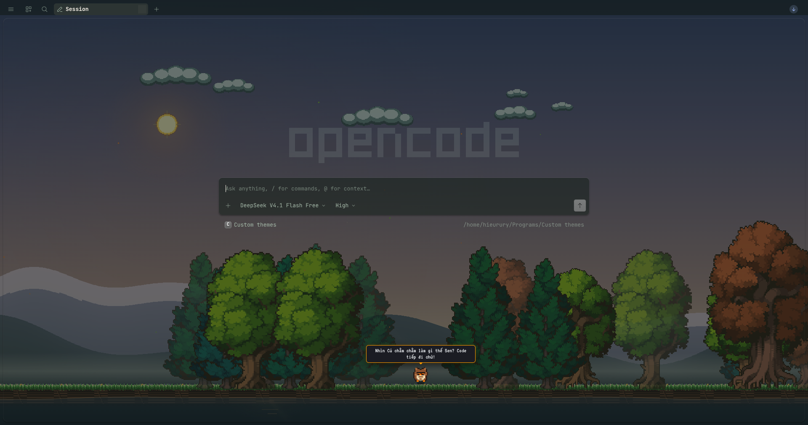
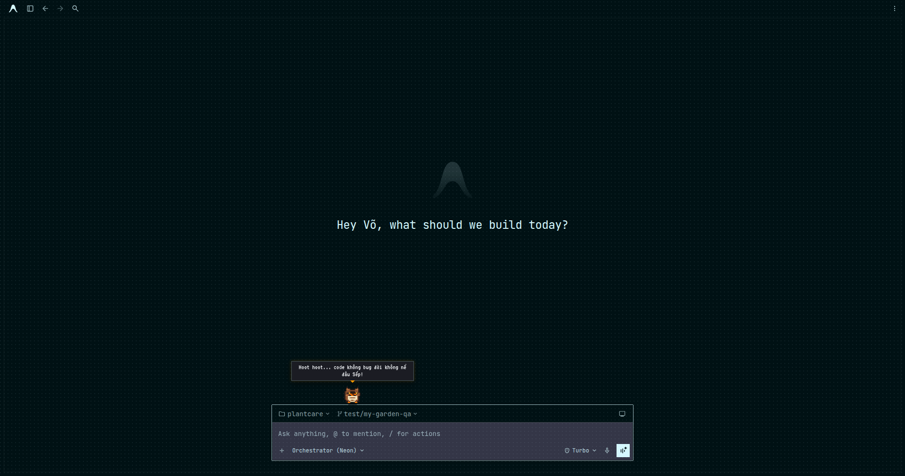

# Custom Harness

Make your AI development workspace feel more like your own. Custom Harness is
an extensible toolkit for visual themes, typography, effects, and interactive
companions. Modular integrations make room for additional tools over time; the
installer lists the integrations supported by each build.

  
  

## What you can customize

- Pixel 16-bit and Primeval Forest themes, with configurable palettes and effects.
- Fonts and code typography, plus an optional interactive pixel-art companion.
- Independent settings for each supported application.
- A shared installer that keeps your existing preferences when updating.
- A command-line installation path for users who prefer the terminal.

## Install

**Easiest:** when a release is published, download the installer for your
operating system from
[Releases](https://github.com/hieurury/custom-harness/releases), run it, choose
an available integration, and follow the on-screen steps. This repository is
public, but draft releases are not available until published.

**Terminal:** see the [installation guide](docs/installation.md) for Linux,
Windows, and macOS instructions and prerequisites.

After installing, open the target application and use its Harness entry point
to choose a theme and preferences. The installer also supports applying or
restoring the integration.

## Updates

The installer checks GitHub Releases at launch and lets you download a newer
installer when one is available. GitHub must allow the installer to read the
release; private repositories require an authorized distribution method.
Details are in [the update and release guide](docs/releasing.md).

## Project status

This is an independent community project and is not affiliated with the
developers of supported applications. It modifies application startup files to
load its runtime; after an application update, you may need to re-apply the
integration. The installer creates a backup and includes a restore option.

See [installation](docs/installation.md),
[configuration](docs/configuration.md), and
[third-party notices](THIRD_PARTY_NOTICES.md) and
[licensing guidance](docs/licensing.md). Project-authored source code is
licensed under the [MIT License](LICENSE); third-party assets retain their own
terms.
